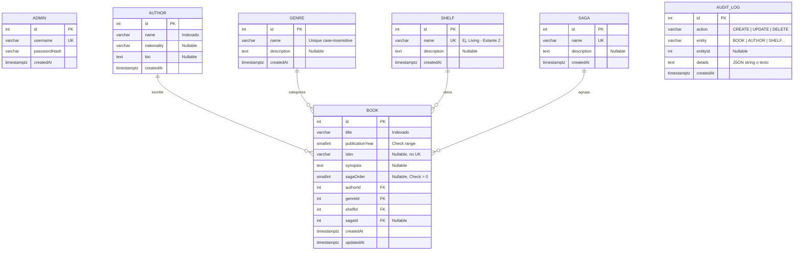
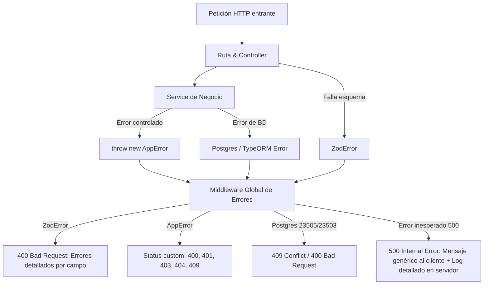
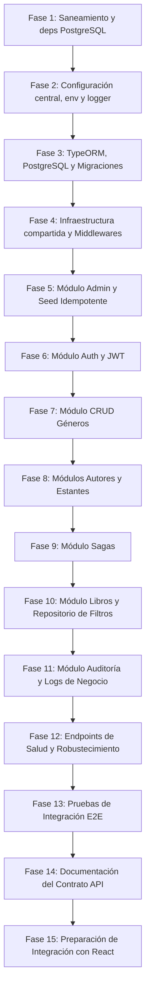

# Plan de Arquitectura Inicial — Backend Gestor de Biblioteca Personal

> **Documento:** `PLAN.md`  
> **Proyecto:** `gestor-biblioteca-tp2 / back-tp-biblioteca`  
> **Rol:** Senior Backend Engineer & Software Architect  
> **Estado:** Propuesta técnica completa para revisión y aprobación previa a la implementación.  
> **Regla de oro:** No implementar código hasta que este plan cuente con la aprobación explícita del usuario.

---

## 1. Resumen de la arquitectura recomendada

### 1.1. Filosofía de diseño y principios rectores
El backend está concebido como una **API REST modular orientada al dominio**, diseñada bajo los principios de:
1. **Simplicidad pragmática (KISS & YAGNI):** Evitar capas de abstracción artificiales (como DTOs duplicados, factories complejas o repositorios genéricos que solo envuelven métodos de TypeORM).
2. **Separación estricta de responsabilidades:**
   - **Transporte HTTP (Routes/Controllers):** Recibe solicitudes, aplica validaciones y formatea respuestas HTTP.
   - **Lógica de negocio (Services):** Orquesta casos de uso, aplica reglas del dominio y gestiona transacciones.
   - **Validación de bordes (Zod Schemas):** Garantiza que ningún dato mal formado o inesperado traspase la frontera HTTP.
   - **Persistencia (TypeORM Entities):** Modela el esquema relacional en PostgreSQL y administra el ciclo de vida de los datos.
3. **Seguridad por defecto:** Principio de mínimo privilegio, sanitización estricta de entradas con Zod, exclusión automática de credenciales (`passwordHash`), contraseñas hasheadas con `bcrypt` (10-12 rondas de salt) y JWT firmado con algoritmos seguros.
4. **Mantenibilidad y tipado estricto:** TypeScript en modo `strict`, aprovechando la inferencia de tipos de Zod (`z.infer<typeof Schema>`) para no duplicar interfaces manuales.

### 1.2. Stack tecnológico y justificación técnica

| Tecnología | Rol | Justificación técnica |
| :--- | :--- | :--- |
| **Node.js (LTS v20+)** | Runtime | Entorno de ejecución estándar, asíncrono y de alto rendimiento para I/O intensivo. |
| **TypeScript (v5+)** | Lenguaje | Tipado estático en tiempo de compilación, autocompletado y detección temprana de errores de contrato. |
| **Express.js (v5)** | Web Framework | Estándar de la industria, minimalista y con soporte nativo de promesas en manejadores de ruta y middlewares. |
| **PostgreSQL (v15+)** | Base de datos relacional | ACID estricto, soporte robusto para integridad referencial, índices funcionales (ej. `LOWER(name)`) e índices parciales condicionales. |
| **TypeORM (v0.3+)** | ORM de persistencia | Mapeo objeto-relacional mediante decoradores, sistema de migraciones declarativas y soporte para QueryBuilder. |
| **Zod (v3.24+)** | Validación y esquemas | Validación declarativa de esquemas en tiempo de ejecución con inferencia estática de tipos. Evita la necesidad de clases DTO separadas. |
| **bcrypt** | Hashing de contraseñas | Algoritmo resistente a ataques por fuerza bruta y timing attacks mediante función de derivación de claves con salt. |
| **jsonwebtoken** | Autenticación | Emisión y verificación de tokens JWT sin estado (stateless) para sesiones del administrador. |
| **cors** | Seguridad HTTP | Middleware para habilitar y restringir los orígenes autorizados del frontend (React). |
| **dotenv** | Variables de entorno | Carga de configuraciones desde archivos `.env` sin acoplar secretos al código fuente. |
| **pino & pino-http** *(Recomendado)* | Logging de infraestructura | Logger JSON estructurado de ultra-alto rendimiento (muy superior a `console.log` o Winston en overhead), con soporte para `pino-pretty` en desarrollo. |

### 1.3. Diagnóstico del estado actual del repositorio (`back-tp-biblioteca`)
Tras la inspección del código existente se observan los siguientes hallazgos críticos:
- **Dependencia de base de datos desalineada:** `package.json` declara `mysql2` y scripts configurados para MySQL. Se debe migrar a `pg` y `@types/pg` para PostgreSQL.
- **Transición incompleta de módulos:** Existen carpetas residuales y archivos huérfanos de un proyecto anterior (e-commerce con `products`, `cart`, `cartItem` y `user`). Algunos archivos fueron borrados en el árbol de trabajo pero aún están referenciados por `src/config/data-source.ts`, `src/routes.ts` y `src/middlewares/auth.middleware.ts`, lo que impide la compilación limpia del proyecto.
- **Tipos de columnas incompatibles con PostgreSQL:** La entidad tentativa `admin.entity.ts` utiliza `datetime` (tipo de MySQL) en lugar de `timestamp with time zone` (`timestamptz`).
- **Archivos vacíos:** `products.controller.ts`, `admin.controller.ts`, etc., que deben ser removidos o reemplazados ordenadamente.

---

## 2. Análisis del modelo de datos y relaciones

### 2.1. Debate arquitectónico: ¿Obra bibliográfica vs. Ejemplar físico?
El requerimiento solicita evaluar explícitamente si conviene separar una obra de sus copias físicas:

#### Opción A: Modelo unificado centrado en el ejemplar (`Book`) — *Recomendada*
Cada fila de la tabla `books` representa un libro físico específico que está ubicado en un estante concreto.
- **Ventajas:**
  - Máxima simplicidad de desarrollo tanto en backend como en frontend.
  - No requiere pantallas anidadas en React (por ejemplo: "Crear Obra" -> "Crear Edición" -> "Crear Ejemplar").
  - Menor cantidad de JOINs en consultas habituales de listado y filtrado.
  - Se adapta con total fidelidad a una biblioteca personal típica, donde el 98% de los libros son copias únicas.
- **Desventajas:**
  - Si el usuario tiene dos copias del mismo título (ej. una edición en tapa blanda y otra ilustrada), se duplica la sinopsis y el título en la base de datos.
- **Mitigación:** Dejar el campo `isbn` como **no único**, permitiendo que dos ejemplares compartan ISBN si el usuario adquiere duplicados.

#### Opción B: Modelo bibliotecológico formal FRBR (`Work` -> `Edition` -> `Item`)
Separa la "Obra intelectual" (ej. *Cien años de soledad*), la "Edición" (año, editorial, ISBN) y el "Ítem físico" (estante, estado de conservación, código de barras).
- **Ventajas:** Pureza teórica y normalización formal de base de datos.
- **Desventajas:**
  - **Sobreingeniería (Accidental Complexity):** Triplica las entidades, repositorios, schemas de Zod, endpoints y componentes de React.
  - Fricción de usuario alta: para registrar un libro, el administrador debería llenar tres formularios en cascada.
- **Veredicto y Recomendación:** **Adoptar la Opción A (Modelo unificado de `Book`)**. Para un sistema de biblioteca personal monousuario, la Opción B agrega complejidad injustificada sin aportar valor real al usuario final.

---

### 2.2. Entidades detalladas y restricciones relacionales



#### 1. Entidad `Admin`
- `id`: `SERIAL` / entero autoincremental, Primary Key.
- `username`: `VARCHAR(50)`, `NOT NULL`, `UNIQUE`.
- `passwordHash`: `VARCHAR(255)`, `NOT NULL`. Configurada con `{ select: false }` en TypeORM para evitar que cualquier consulta descuidada (`find()`) incluya el hash en memoria.
- `createdAt`: `TIMESTAMPTZ`, `NOT NULL`, default `CURRENT_TIMESTAMP`.
- **Regla de negocio:** No existe registro público. La creación del administrador inicial se ejecuta mediante un seeder idempotente guiado por variables de entorno.

#### 2. Entidad `Author`
- `id`: `SERIAL`, Primary Key.
- `name`: `VARCHAR(150)`, `NOT NULL`. **No es único** (pueden coexistir autores homónimos).
- `nationality`: `VARCHAR(100)`, `NULLABLE`.
- `bio`: `TEXT`, `NULLABLE`.
- `createdAt`: `TIMESTAMPTZ`, default `CURRENT_TIMESTAMP`.
- **Índice:** `CREATE INDEX idx_authors_name ON authors(name);` para acelerar búsquedas y ordenamientos alfabéticos.

#### 3. Entidad `Genre`
- `id`: `SERIAL`, Primary Key.
- `name`: `VARCHAR(80)`, `NOT NULL`.
- `description`: `TEXT`, `NULLABLE`.
- `createdAt`: `TIMESTAMPTZ`, default `CURRENT_TIMESTAMP`.
- **Unicidad insensible a mayúsculas y minúsculas (Case-Insensitive):**
  - *En base de datos:* `CREATE UNIQUE INDEX uq_genres_name_lower ON genres (LOWER(name));`
  - *En Zod/Service:* Normalización con `.trim()` en Zod y verificación previa en el `GenreService` consultando `LOWER(name) = LOWER(:input)`.

#### 4. Entidad `Saga`
- `id`: `SERIAL`, Primary Key.
- `name`: `VARCHAR(150)`, `NOT NULL`, `UNIQUE`.
- `description`: `TEXT`, `NULLABLE`.
- `createdAt`: `TIMESTAMPTZ`, default `CURRENT_TIMESTAMP`.

#### 5. Entidad `Shelf` (Estante / Ubicación física)
- `id`: `SERIAL`, Primary Key.
- `name`: `VARCHAR(80)`, `NOT NULL`, `UNIQUE`. (Ejemplo: `Living - Estante 2`, `Estudio - Biblioteca Principal A`).
- `description`: `TEXT`, `NULLABLE`.
- `createdAt`: `TIMESTAMPTZ`, default `CURRENT_TIMESTAMP`.

#### 6. Entidad `Book`
- `id`: `SERIAL`, Primary Key.
- `title`: `VARCHAR(255)`, `NOT NULL`.
- `publicationYear`: `SMALLINT`, `NOT NULL`. Restricción: `CHECK (publication_year >= 0 AND publication_year <= 2100)`.
- `isbn`: `VARCHAR(20)`, `NULLABLE`. Sin índice único (múltiples ejemplares pueden compartir ISBN).
- `synopsis`: `TEXT`, `NULLABLE`.
- `sagaOrder`: `SMALLINT`, `NULLABLE`. Restricción: `CHECK (saga_order > 0)`.
- `authorId`: `INTEGER`, `NOT NULL`, FK -> `authors(id)`.
- `genreId`: `INTEGER`, `NOT NULL`, FK -> `genres(id)`.
- `shelfId`: `INTEGER`, `NOT NULL`, FK -> `shelves(id)`.
- `sagaId`: `INTEGER`, `NULLABLE`, FK -> `sagas(id)`.
- `createdAt`: `TIMESTAMPTZ`, default `CURRENT_TIMESTAMP`.
- `updatedAt`: `TIMESTAMPTZ`, default `CURRENT_TIMESTAMP`.

**Restricciones de integridad referencial (`ON DELETE`):**
- `authorId`, `genreId`, `shelfId`: `ON DELETE RESTRICT`. Si un autor, género o estante tiene libros asignados, la base de datos rechaza la eliminación con un error de integridad referencial. Esto protege contra pérdidas accidentales de catálogo.
- `sagaId`: `ON DELETE SET NULL`. Si se elimina una saga, los libros que formaban parte de ella no se destruyen; simplemente su campo `sagaId` pasa a `NULL` (y el servicio se encarga de setear `sagaOrder = NULL`).

**Unicidad condicional de orden dentro de una saga:**
Para evitar que dos libros tengan la misma posición dentro de una misma saga:
```sql
CREATE UNIQUE INDEX uq_books_saga_order 
ON books (saga_id, saga_order) 
WHERE saga_id IS NOT NULL AND saga_order IS NOT NULL;
```

**Índices para filtros combinados:**
```sql
CREATE INDEX idx_books_author_id ON books(author_id);
CREATE INDEX idx_books_genre_id ON books(genre_id);
CREATE INDEX idx_books_shelf_id ON books(shelf_id);
CREATE INDEX idx_books_publication_year ON books(publication_year);
CREATE INDEX idx_books_title ON books(title);
```

#### 7. Entidad `AuditLog` (Registros de eventos de negocio)
Para cumplir con el requerimiento de exponer un historial de eventos al administrador sin exponer logs técnicos del servidor:
- `id`: `SERIAL`, Primary Key.
- `action`: `VARCHAR(20)` (`CREATE`, `UPDATE`, `DELETE`, `AUTH_LOGIN`).
- `entity`: `VARCHAR(50)` (`BOOK`, `AUTHOR`, `GENRE`, `SAGA`, `SHELF`).
- `entityId`: `INTEGER`, `NULLABLE`.
- `details`: `TEXT`, `NULLABLE` (resumen amigable: `"Se creó el libro 'Ficciones' en el estante 'Living 1'"`).
- `createdAt`: `TIMESTAMPTZ`, default `CURRENT_TIMESTAMP`.

---

## 3. Estructura de carpetas propuesta

Se adopta una estructura modular por entidad funcional (Feature Folders), separando claramente los módulos de dominio de los componentes compartidos (Shared Kernel / Cross-cutting Concerns).

```text
back-tp-biblioteca/
├── .env.example
├── .gitignore
├── package.json
├── tsconfig.json
├── PLAN.md
└── src/
    ├── app.ts                  # Configuración de Express, middlewares globales y rutas
    ├── server.ts               # Punto de entrada: arranque de BD, seed y listen HTTP
    ├── routes.ts               # Agregador principal de rutas (/api)
    │
    ├── config/                 # Configuraciones centrales
    │   ├── env.ts              # Validación y tipado de variables de entorno con Zod
    │   ├── data-source.ts      # Instancia central de TypeORM DataSource para PostgreSQL
    │   └── logger.ts           # Configuración del logger Pino
    │
    ├── database/               # Persistencia e infraestructura de BD
    │   ├── migrations/         # Migraciones versionadas generadas por TypeORM
    │   └── seeds/              # Seeders idempotentes (inicialización de Admin)
    │       └── admin.seed.ts
    │
    ├── middlewares/            # Middlewares compartidos reutilizables
    │   ├── auth.middleware.ts  # Verificación de JWT y fijación de contexto
    │   ├── validate.middleware.ts # Validador genérico de Zod (body, query, params)
    │   ├── error.middleware.ts # Manejo global de excepciones y formateo de respuestas
    │   └── request-logger.middleware.ts # Registro HTTP estructurado de peticiones
    │
    ├── shared/                 # Utilidades comunes y tipos transversales
    │   ├── errors/
    │   │   └── app-error.ts    # Clase de error personalizada con códigos HTTP
    │   ├── utils/
    │   │   └── pagination.ts   # Helper para paginación y meta-información
    │   └── types/
    │       └── express.d.ts    # Extensión de tipos de Express (req.adminId)
    │
    └── modules/                # Módulos de dominio de la aplicación
        ├── auth/
        │   ├── auth.controller.ts
        │   ├── auth.routes.ts
        │   ├── auth.service.ts
        │   └── auth.schema.ts
        │
        ├── admin/
        │   └── admin.entity.ts # Solo entidad para persistencia y seed (sin CRUD público)
        │
        ├── authors/
        │   ├── author.entity.ts
        │   ├── author.controller.ts
        │   ├── author.routes.ts
        │   ├── author.service.ts
        │   └── author.schema.ts
        │
        ├── genres/
        │   ├── genre.entity.ts
        │   ├── genre.controller.ts
        │   ├── genre.routes.ts
        │   ├── genre.service.ts
        │   └── genre.schema.ts
        │
        ├── sagas/
        │   ├── saga.entity.ts
        │   ├── saga.controller.ts
        │   ├── saga.routes.ts
        │   ├── saga.service.ts
        │   └── saga.schema.ts
        │
        ├── shelves/
        │   ├── shelf.entity.ts
        │   ├── shelf.controller.ts
        │   ├── shelf.routes.ts
        │   ├── shelf.service.ts
        │   └── shelf.schema.ts
        │
        ├── books/
        │   ├── book.entity.ts
        │   ├── book.controller.ts
        │   ├── book.routes.ts
        │   ├── book.service.ts
        │   ├── book.repository.ts  # Justificado: consultas complejas y filtros combinados
        │   └── book.schema.ts
        │
        └── logs/
            ├── audit-log.entity.ts
            ├── audit-log.controller.ts
            ├── audit-log.routes.ts
            ├── audit-log.service.ts
            └── audit-log.schema.ts
```

---

## 4. Responsabilidades de cada capa

### 4.1. Entity (`*.entity.ts`)
- **Propósito:** Representa la tabla física en PostgreSQL.
- **Responsabilidad:** Mapear columnas, tipos de datos SQL, valores por defecto, claves primarias y relaciones foráneas (`@ManyToOne`, `@OneToMany`).
- **Regla:** No contiene lógica de negocio ni validaciones de formato de usuario.

### 4.2. Routes (`*.routes.ts`)
- **Propósito:** Definir los endpoints de la API para cada recurso.
- **Responsabilidad:** Asociar cada verbo HTTP y path con sus respectivos middlewares de validación (`validateBody`, `validateParams`, `validateQuery`), middleware de autenticación (`requireAuth`) y el método del controlador.
- **Regla:** Código declarativo puro. Cero lógica de negocio.

### 4.3. Controller (`*.controller.ts`)
- **Propósito:** Manejar el protocolo HTTP.
- **Responsabilidad:**
  - Extraer los datos validados de `req.body`, `req.params` o `req.query`.
  - Invocar al método correspondiente del Service.
  - Devolver la respuesta con el código de estado HTTP adecuado (`200 OK`, `201 Created`, `204 No Content`) utilizando la estructura uniforme de respuesta.
- **Regla:** No consulta la base de datos ni ejecuta validaciones manuales. Cualquier error no capturado se delega a `next(error)`.

### 4.4. Service (`*.service.ts`)
- **Propósito:** Núcleo de las reglas de negocio de la aplicación.
- **Responsabilidad:**
  - Verificar reglas del dominio (ej. corroborar que el autor, género y estante existan antes de asociarlos a un libro).
  - Verificar que un nombre de género no esté duplicado en minúsculas.
  - Verificar que `sagaOrder` no colisione con otro libro de la misma saga.
  - Coordinar la inserción de registros de auditoría (`AuditLogService`).
  - Disparar errores de negocio tipados (`AppError.notFound`, `AppError.conflict`, `AppError.badRequest`).
- **Regla:** Desacoplado totalmente de Express. No recibe ni manipula objetos `req` o `res`.

### 4.5. Repository (`*.repository.ts`): Criterio de uso
TypeORM ya ofrece un repositorio genérico nativo (`AppDataSource.getRepository(Entity)`).
- **Módulos estándar (Authors, Genres, Sagas, Shelves):** No se crean archivos de repositorio adicionales. El service utiliza directamente `AppDataSource.getRepository(Entity)`. Crear una clase solo para llamar a `.find()` o `.save()` es una abstracción redundante sin valor.
- **Módulo complejo (`Book`):** **Sí se justifica un `book.repository.ts`**. Las consultas de catálogo requieren combinar múltiples filtros dinámicos (autor, género, año), paginar, ordenar y cargar relaciones específicas mediante `QueryBuilder` optimizado. Aislar esta complejidad SQL en un repositorio propio mantiene el `book.service.ts` limpio y enfocado exclusivamente en las reglas de negocio.

### 4.6. Schemas de Zod (`*.schema.ts`)
- **Propósito:** Validar el contrato de datos entrantes desde la red.
- **Responsabilidad:** Definir reglas estrictas de tipo, obligatoriedad, rango numérico, saneamiento de espacios (`.trim()`) y rechazo de claves desconocidas (`.strict()`).
- **Regla:** Reemplaza completamente a los DTOs manuales. Se exportan los tipos inferidos:
  ```typescript
  export type CreateBookInput = z.infer<typeof createBookSchema>;
  export type UpdateBookInput = z.infer<typeof updateBookSchema>;
  ```

---

## 5. Estrategia de schemas de Zod

### 5.1. Distinción de los tres niveles de validación
Para que el sistema sea robusto, se diferencian claramente tres niveles que no deben confundirse:
1. **Validación sintáctica y de bordes (Zod):** ¿Es un string no vacío? ¿Tiene menos de 255 caracteres? ¿El año es un número entero? ¿Llegaron campos extraños no permitidos?
2. **Validación semántica y de negocio (Service):** ¿Existe el `authorId` en la base de datos? ¿El estante tiene espacio o pertenece a la categoría correcta? ¿El autor ya tiene un libro con el mismo título en el mismo año?
3. **Integridad de persistencia (Base de datos):** Restricciones `FOREIGN KEY`, `CHECK`, `UNIQUE` e índices funcionales que protegen contra condiciones de carrera concurrentes.

### 5.2. Política contra propiedades desconocidas (`.strict()`)
Para todos los schemas de mutación (`POST`, `PUT`, `PATCH`), se utilizará `.strict()`. Si un cliente malicioso o desactualizado envía campos no contemplados (ej. `{ "title": "X", "isAdmin": true }`), Zod rechazará la petición con un `400 Bad Request` indicando la clave no permitida.

### 5.3. Schemas de creación vs. actualización
- **Creación (`createBookSchema`):** Todos los campos obligatorios son exigidos explícitamente (`title`, `authorId`, `genreId`, `shelfId`, `publicationYear`).
- **Actualización (`updateBookSchema`):** Se deriva del schema de creación mediante `.partial()`, exigiendo que al menos un campo sea enviado para evitar peticiones vacías:
  ```typescript
  export const updateBookSchema = createBookSchema.partial().refine(
    (data) => Object.keys(data).length > 0,
    { message: "Debe proporcionar al menos un campo para actualizar" }
  );
  ```

### 5.4. Validación de parámetros de ruta y queries
- **Route Params (`idParamSchema`):**
  ```typescript
  export const idParamSchema = z.object({
    id: z.coerce.number({ message: "El ID debe ser un número" })
      .int("El ID debe ser un número entero")
      .positive("El ID debe ser mayor a 0"),
  });
  ```
- **Query Params de filtrado (`bookFilterQuerySchema`):**
  ```typescript
  export const bookFilterQuerySchema = z.object({
    authorId: z.coerce.number().int().positive().optional(),
    genreId: z.coerce.number().int().positive().optional(),
    publicationYear: z.coerce.number().int().min(0).max(2100).optional(),
    shelfId: z.coerce.number().int().positive().optional(),
    sagaId: z.coerce.number().int().positive().optional(),
    search: z.string().trim().max(100).optional(),
    page: z.coerce.number().int().positive().default(1),
    limit: z.coerce.number().int().positive().max(100).default(20),
  });
  ```

### 5.5. Middleware reutilizable de validación
Se implementará un middleware flexible y seguro en `src/middlewares/validate.middleware.ts` que permite validar cualquier parte de la petición (`body`, `query` o `params`) y reemplazar el valor con los datos ya parseados, tipados y sanitizados por Zod:

```typescript
// Firma de la función
export const validate = (target: "body" | "query" | "params", schema: z.ZodTypeAny) => 
  (req: Request, _res: Response, next: NextFunction) => {
    try {
      const parsed = schema.parse(req[target]);
      req[target] = parsed; // Sobrescribe con datos sanitizados
      next();
    } catch (error) {
      next(error); // ErrorMiddleware captura ZodError y responde 400
    }
  };
```

---

## 6. Estrategia de autenticación y seguridad

### 6.1. Modelo monousuario de Administrador
No existe registro público ni multiplicidad de roles. El sistema pertenece y sirve únicamente al dueño de la biblioteca.

#### Inicialización idempotente (Seeder)
- Al arrancar la aplicación (`src/server.ts`), se invoca `seedAdmin()`.
- Verifica en la tabla `admin` si ya existe el usuario definido por `ADMIN_USERNAME` (de `.env`).
- Si **no existe**, genera el hash con `bcrypt.hash(ADMIN_PASSWORD, 10)` y crea el registro.
- Si **ya existe**, no realiza ninguna acción. Ejecutar el seeder N veces produce el mismo resultado seguro.

### 6.2. Autenticación JWT sin estado (Stateless)
1. **Endpoint `POST /api/auth/login`:**
   - Valida el payload con `loginSchema` (`username` y `password`).
   - Busca al administrador por `username` seleccionando explícitamente `passwordHash`.
   - Compara contraseñas con `bcrypt.compare`.
   - Si el usuario no existe o la contraseña no coincide, **siempre** devuelve `401 Unauthorized` con el mensaje neutro: `"Credenciales inválidas"`. Esto evita ataques de enumeración de usuarios.
   - Si es válido, emite un JWT firmado:
     - **Payload:** `{ sub: admin.id, username: admin.username }`
     - **Duración:** configurable vía `JWT_EXPIRES_IN` (ej. `8h`).
     - **Firma:** Algoritmo `HS256` con `JWT_SECRET` (mínimo 32 caracteres criptográficos).

2. **Middleware `requireAuth` (`src/middlewares/auth.middleware.ts`):**
   - Extrae el encabezado `Authorization: Bearer <token>`.
   - Si no está presente o no tiene el prefijo `Bearer `, arroja `AppError.unauthorized("Token de autorización requerido")`.
   - Verifica la firma y expiración con `jwt.verify()`.
   - Inyecta `req.adminId = payload.sub` en el request para que los controllers y servicios puedan auditar la acción.

### 6.3. Cierre de sesión (Logout) y almacenamiento de token en React
En una arquitectura con JWT sin estado:
- El servidor **no mantiene sesiones en memoria ni en base de datos**.
- Por lo tanto, el "Logout" es una **operación puramente del cliente (frontend)**: React elimina el token de su almacenamiento local (memoria de estado o `localStorage`) y redirige al login.
- **Limitación técnica fundamental:** Un token JWT emitido sigue siendo criptográficamente válido hasta su fecha de expiración natural. Para una biblioteca personal con un único administrador, implementar una lista negra (blacklist) de tokens en Redis o PostgreSQL introduce una complejidad innecesaria. El riesgo se mitiga adecuadamente configurando un tiempo de expiración razonable (ej. entre 2 y 8 horas).
- **Estrategia para React:** Se utilizará el encabezado estándar `Authorization: Bearer <token>`. El token se resguarda en el cliente y se adjunta a cada petición mediante un interceptor de Axios o cliente Fetch.

### 6.4. Políticas de seguridad complementarias
- **Ocultamiento de `passwordHash`:** La columna en `Admin` tiene `select: false`. Ningún query por defecto traerá el hash. En el login se pide explícitamente con `.addSelect("admin.passwordHash")`.
- **CORS estricto:** Configurado mediante `cors({ origin: env.corsOrigins, credentials: true })`. En `.env` se definen los orígenes del frontend (ej. `http://localhost:5173`).
- **Encabezados HTTP:** `app.disable("x-powered-by")` para evitar fugas de información sobre el stack.
- **Validación estricta de variables de entorno al arranque:** Si falta `JWT_SECRET` o la conexión a la base de datos es errónea, el proceso finaliza inmediatamente con un mensaje de error claro en consola, impidiendo que el servidor arranque en un estado inseguro.

---

## 7. Contrato inicial de la API

### 7.1. Convención uniforme de respuestas

#### Respuesta exitosa estándar (200 OK / 201 Created)
```json
{
  "success": true,
  "data": { ... }
}
```

#### Respuesta paginada estándar (200 OK)
```json
{
  "success": true,
  "data": [ ... ],
  "pagination": {
    "page": 1,
    "limit": 20,
    "totalItems": 154,
    "totalPages": 8,
    "hasNextPage": true,
    "hasPrevPage": false
  }
}
```

#### Respuesta de error estándar (4xx / 5xx)
```json
{
  "success": false,
  "error": {
    "code": "BAD_REQUEST | NOT_FOUND | CONFLICT | UNAUTHORIZED | VALIDATION_ERROR | INTERNAL_ERROR",
    "message": "Descripción clara del error en español",
    "details": [
      {
        "field": "publicationYear",
        "message": "El año de publicación debe ser menor o igual a 2026"
      }
    ]
  }
}
```

---

### 7.2. Catálogo de endpoints

#### Autenticación (`/api/auth`)
| Método | Endpoint | Acceso | Descripción | Códigos HTTP |
| :--- | :--- | :--- | :--- | :--- |
| `POST` | `/api/auth/login` | Público | Inicia sesión con `username` y `password` | 200, 400, 401 |
| `GET` | `/api/auth/me` | Privado | Obtiene los datos del administrador autenticado | 200, 401 |
| `POST` | `/api/auth/logout` | Privado | Confirmación formal de logout (limpieza en cliente) | 200, 401 |

#### Libros (`/api/books`)
| Método | Endpoint | Acceso | Descripción | Códigos HTTP |
| :--- | :--- | :--- | :--- | :--- |
| `GET` | `/api/books` | Privado | Lista libros con filtros combinados (`authorId`, `genreId`, `year`, `shelfId`, `sagaId`, `search`) y paginación | 200, 400, 401 |
| `GET` | `/api/books/:id` | Privado | Detalle de un libro incluyendo relaciones completas (`author`, `genre`, `shelf`, `saga`) | 200, 400, 401, 404 |
| `POST` | `/api/books` | Privado | Crea un nuevo ejemplar físico | 201, 400, 401, 404, 409 |
| `PUT` | `/api/books/:id` | Privado | Actualiza los datos de un ejemplar existente | 200, 400, 401, 404, 409 |
| `DELETE` | `/api/books/:id` | Privado | Elimina un ejemplar físico | 204, 400, 401, 404 |

**Representación del detalle de un libro (`GET /api/books/:id`):**
```json
{
  "success": true,
  "data": {
    "id": 12,
    "title": "El nombre del viento",
    "publicationYear": 2007,
    "isbn": "978-8401352836",
    "synopsis": "Crónica del asesino de reyes: primer día...",
    "sagaOrder": 1,
    "createdAt": "2026-03-15T12:00:00Z",
    "updatedAt": "2026-03-15T12:00:00Z",
    "author": {
      "id": 4,
      "name": "Patrick Rothfuss",
      "nationality": "Estadounidense"
    },
    "genre": {
      "id": 2,
      "name": "Fantasía épica"
    },
    "shelf": {
      "id": 1,
      "name": "Living - Estante Principal"
    },
    "saga": {
      "id": 3,
      "name": "Crónica del asesino de reyes"
    }
  }
}
```

#### Autores (`/api/authors`)
| Método | Endpoint | Acceso | Descripción | Códigos HTTP |
| :--- | :--- | :--- | :--- | :--- |
| `GET` | `/api/authors` | Privado | Lista todos los autores (soporta filtro `?search=`) | 200, 401 |
| `GET` | `/api/authors/:id` | Privado | Detalle de un autor con listado resumido de sus libros | 200, 400, 401, 404 |
| `POST` | `/api/authors` | Privado | Crea un autor | 201, 400, 401 |
| `PUT` | `/api/authors/:id` | Privado | Actualiza los datos de un autor | 200, 400, 401, 404 |
| `DELETE` | `/api/authors/:id` | Privado | Elimina un autor (falla con 409 si tiene libros vinculados) | 204, 400, 401, 404, 409 |

#### Géneros (`/api/genres`)
| Método | Endpoint | Acceso | Descripción | Códigos HTTP |
| :--- | :--- | :--- | :--- | :--- |
| `GET` | `/api/genres` | Privado | Lista todos los géneros ordenados alfabéticamente | 200, 401 |
| `GET` | `/api/genres/:id` | Privado | Detalle de un género | 200, 400, 401, 404 |
| `POST` | `/api/genres` | Privado | Crea un género (valida unicidad case-insensitive) | 201, 400, 401, 409 |
| `PUT` | `/api/genres/:id` | Privado | Actualiza un género | 200, 400, 401, 404, 409 |
| `DELETE` | `/api/genres/:id` | Privado | Elimina un género (falla con 409 si tiene libros vinculados) | 204, 400, 401, 404, 409 |

#### Sagas (`/api/sagas`)
| Método | Endpoint | Acceso | Descripción | Códigos HTTP |
| :--- | :--- | :--- | :--- | :--- |
| `GET` | `/api/sagas` | Privado | Lista todas las sagas | 200, 401 |
| `GET` | `/api/sagas/:id` | Privado | Detalle de saga con sus libros ordenados por `sagaOrder` | 200, 400, 401, 404 |
| `POST` | `/api/sagas` | Privado | Crea una saga (nombre único) | 201, 400, 401, 409 |
| `PUT` | `/api/sagas/:id` | Privado | Actualiza una saga | 200, 400, 401, 404, 409 |
| `DELETE` | `/api/sagas/:id` | Privado | Elimina una saga (los libros pasan a tener `sagaId = NULL`) | 204, 400, 401, 404 |

#### Estantes (`/api/shelves`)
| Método | Endpoint | Acceso | Descripción | Códigos HTTP |
| :--- | :--- | :--- | :--- | :--- |
| `GET` | `/api/shelves` | Privado | Lista todos los estantes | 200, 401 |
| `GET` | `/api/shelves/:id` | Privado | Detalle de un estante y los libros allí almacenados | 200, 400, 401, 404 |
| `POST` | `/api/shelves` | Privado | Crea un estante (nombre/código único) | 201, 400, 401, 409 |
| `PUT` | `/api/shelves/:id` | Privado | Actualiza un estante | 200, 400, 401, 404, 409 |
| `DELETE` | `/api/shelves/:id` | Privado | Elimina un estante (falla con 409 si contiene libros) | 204, 400, 401, 404, 409 |

#### Registro de Actividad / Auditoría (`/api/logs`)
| Método | Endpoint | Acceso | Descripción | Códigos HTTP |
| :--- | :--- | :--- | :--- | :--- |
| `GET` | `/api/logs` | Privado | Consulta el historial paginado de eventos de negocio | 200, 401 |

#### Verificación de Salud (`/api/health`)
| Método | Endpoint | Acceso | Descripción | Códigos HTTP |
| :--- | :--- | :--- | :--- | :--- |
| `GET` | `/api/health` | Público | Verifica el estado del servidor y la conexión a PostgreSQL | 200, 503 |

---

## 8. Base de datos y migraciones

### 8.1. Estrategia de migraciones con TypeORM
- **Prohibición absoluta de `synchronize: true` en producción:** `synchronize` altera tablas en caliente sin control de versiones, pudiendo borrar columnas o generar bloqueos en la base de datos.
- **Flujo de desarrollo:**
  1. Se modifican o crean las entidades TypeScript en `src/modules/**/entity.ts`.
  2. Se ejecuta el comando de TypeORM CLI para generar la migración diferencial:
     ```bash
     npm run migration:generate -- src/database/migrations/NombreDelCambio
     ```
  3. Se inspecciona manualmente el archivo `.ts` generado en `src/database/migrations/` para comprobar que las sentencias SQL coincidan exactamente con la intención del diseño.
  4. Se aplica la migración a la base de datos:
     ```bash
     npm run migration:run
     ```
  5. En caso de error o reversión:
     ```bash
     npm run migration:revert
     ```

### 8.2. Configuración del `DataSource` (`src/config/data-source.ts`)
```typescript
import "reflect-metadata";
import { DataSource } from "typeorm";
import { env } from "./env.js";

export const AppDataSource = new DataSource({
  type: "postgres",
  host: env.db.host,
  port: env.db.port,
  username: env.db.user,
  password: env.db.password,
  database: env.db.name,
  synchronize: false, // ¡Siempre false! Las migraciones controlan el esquema
  logging: env.nodeEnv === "development" ? ["error", "warn", "migration"] : ["error"],
  entities: ["src/modules/**/*.entity.ts"],
  migrations: ["src/database/migrations/*.ts"],
  subscribers: [],
});
```

### 8.3. Manejo de errores nativos de PostgreSQL en TypeORM
Cuando ocurre un error a nivel motor SQL, PostgreSQL devuelve códigos de error alfanuméricos estandarizados. El middleware global de errores interceptará estos códigos para convertirlos en respuestas HTTP limpias:
- **`23505` (unique_violation):** Se traduce a `409 Conflict` (ej. "Ya existe un género con ese nombre").
- **`23503` (foreign_key_violation):**
  - Al insertar/actualizar: `400 Bad Request` ("El autor especificado no existe").
  - Al borrar: `409 Conflict` ("No se puede eliminar el autor porque tiene libros asociados").
- **`23514` (check_violation):** Se traduce a `400 Bad Request` (ej. "El año de publicación está fuera del rango permitido").

---

## 9. Logging y manejo de errores

### 9.1. Separación de dos niveles de Logging
Es fundamental distinguir dos conceptos que frecuentemente se confunden:

| Concepto | **Logs de Infraestructura / Técnicos** | **Logs de Auditoría / Negocio** |
| :--- | :--- | :--- |
| **Audiencia** | Desarrollador / DevOps / Administrador de sistemas | Administrador de la biblioteca desde el frontend React |
| **Destino** | Consola `stdout` (vía Pino) o archivos de log rotativos | Tabla relacional `audit_logs` en PostgreSQL |
| **Contenido** | Método HTTP, ruta, IP, tiempo de respuesta (ms), stacktrace de errores 500 | "Se creó el libro X", "Se actualizó el estante Y", "Inicio de sesión" |
| **Seguridad** | **Nunca** registra contraseñas, tokens JWT ni datos sensibles | Solo registra identificadores y nombres de recursos |
| **Acceso API** | No expuesto por API REST | Expuesto mediante `GET /api/logs` |

### 9.2. Logger de Infraestructura con `Pino`
- Se utilizará `pino` junto a un middleware de logging `pino-http` en `src/middlewares/request-logger.middleware.ts`.
- Formato en desarrollo: formateado legible en consola gracias a `pino-pretty`.
- Formato en producción: JSON estructurado de una sola línea, apto para agregadores de logs.
- Redacción automática de campos sensibles (`req.headers.authorization`, `req.body.password`).

### 9.3. Jerarquía y manejo centralizado de errores



- **Clase personalizada `AppError` (`src/shared/errors/app-error.ts`):**
  Permite lanzar errores de negocio limpios:
  ```typescript
  throw AppError.notFound("El libro solicitado no existe");
  throw AppError.conflict("El código de estante ya está en uso");
  ```
- **Middleware Global (`src/middlewares/error.middleware.ts`):**
  Captura cualquier excepción y garantiza que el cliente reciba siempre el payload estandarizado de error, sin exponer trazas de ejecución en producción.

---

## 10. Plan de implementación por fases

El trabajo se dividirá en 15 fases progresivas, estrictamente secuenciadas para asegurar que cada paso sea compilable y testeable antes de avanzar al siguiente.



---

### Fase 1: Saneamiento del repositorio y dependencias de PostgreSQL
- **Objetivo:** Eliminar archivos residuales que rompen la compilación e instalar el driver de PostgreSQL.
- **Archivos involucrados:** `package.json`, eliminación de carpetas y archivos huérfanos (`src/modules/cart/`, `src/modules/user/`, `src/modules/products/`).
- **Tareas:**
  1. Desinstalar `mysql2` e instalar `pg` y `@types/pg`.
  2. Instalar `pino` y `pino-http`, con `pino-pretty` como devDependency.
  3. Limpiar referencias a `User` o `Product` en `src/routes.ts` y middlewares.
- **Dependencias:** Ninguna.
- **Criterio de aceptación:** `npm run typecheck` no arroja errores de módulos no encontrados.
- **Pruebas:** Ejecutar `tsc --noEmit`.

---

### Fase 2: Configuración central, tipado de `env` y Logger
- **Objetivo:** Garantizar que todas las variables de entorno se validen en el arranque y configurar el logger estructurado.
- **Archivos involucrados:** `src/config/env.ts`, `src/config/logger.ts`, `.env.example`.
- **Tareas:**
  1. Definir schema de Zod para las variables de entorno: `PORT`, `DB_HOST`, `DB_PORT`, `DB_NAME`, `DB_USER`, `DB_PASS`, `JWT_SECRET`, `JWT_EXPIRES_IN`, `CORS_ORIGIN`, `ADMIN_DEFAULT_USER`, `ADMIN_DEFAULT_PASSWORD`.
  2. Configurar la instancia de `Pino` según el entorno (`development` vs `production`).
  3. Crear un `.env.example` completo y documentado.
- **Dependencias:** Fase 1.
- **Criterio de aceptación:** Si falta una variable crítica en `.env`, el servidor aborta el inicio con un mensaje descriptivo.

---

### Fase 3: Conexión TypeORM, DataSource y CLI de Migraciones
- **Objetivo:** Establecer la conexión con PostgreSQL y dejar operativo el sistema de migraciones.
- **Archivos involucrados:** `src/config/data-source.ts`, `package.json` (scripts de migraciones).
- **Tareas:**
  1. Configurar `AppDataSource` para PostgreSQL apuntando a los valores validados de `env`.
  2. Agregar scripts en `package.json`: `typeorm`, `migration:generate`, `migration:run`, `migration:revert`.
- **Dependencias:** Fase 2.
- **Criterio de aceptación:** `AppDataSource.initialize()` se conecta exitosamente a una instancia local de PostgreSQL.

---

### Fase 4: Middlewares compartidos y manejo global de errores
- **Objetivo:** Construir la base de tuberías HTTP para manejo de errores, logging de peticiones y validación genérica.
- **Archivos involucrados:** `src/middlewares/error.middleware.ts`, `src/middlewares/validate.middleware.ts`, `src/middlewares/request-logger.middleware.ts`, `src/shared/errors/app-error.ts`.
- **Tareas:**
  1. Implementar `AppError` con métodos de conveniencia (`notFound`, `badRequest`, `conflict`, `unauthorized`, `forbidden`).
  2. Implementar `validate(target, schema)` reutilizable.
  3. Implementar `errorHandler` que procese `ZodError`, `AppError` y códigos de PostgreSQL.
- **Dependencias:** Fase 3.
- **Criterio de aceptación:** Un endpoint de prueba con datos inválidos responde con código 400 y formato uniforme de error.

---

### Fase 5: Entidad Admin y Seeder Idempotente
- **Objetivo:** Modelar la persistencia del administrador y garantizar su inicialización automática.
- **Archivos involucrados:** `src/modules/admin/admin.entity.ts`, `src/database/seeds/admin.seed.ts`, primera migración inicial.
- **Tareas:**
  1. Crear la entidad `Admin` (`id`, `username`, `passwordHash`, `createdAt`) con tipos de PostgreSQL (`timestamptz`).
  2. Crear y correr la primera migración para la tabla `admin`.
  3. Implementar `seedAdmin()` con `bcrypt.hash()`, verificando existencia previa.
  4. Vincular el seeder al arranque en `src/server.ts`.
- **Dependencias:** Fase 4.
- **Criterio de aceptación:** Iniciar el servidor dos veces consecutivas: la primera crea el admin y la segunda detecta su existencia sin duplicar ni arrojar error.

---

### Fase 6: Autenticación, JWT y Middleware de Protección
- **Objetivo:** Exponer el endpoint de login y proteger las rutas privadas.
- **Archivos involucrados:** `src/modules/auth/auth.schema.ts`, `src/modules/auth/auth.service.ts`, `src/modules/auth/auth.controller.ts`, `src/modules/auth/auth.routes.ts`, `src/middlewares/auth.middleware.ts`.
- **Tareas:**
  1. Definir `loginSchema` (username y password no vacíos).
  2. Implementar `AuthService.login()` con validación timing-safe mediante `bcrypt.compare` y emisión de JWT.
  3. Implementar `requireAuth` para verificar el token Bearer y poblar `req.adminId`.
  4. Implementar endpoints `POST /api/auth/login`, `GET /api/auth/me` y `POST /api/auth/logout`.
- **Dependencias:** Fase 5.
- **Criterio de aceptación:** Login exitoso entrega token; credenciales erróneas devuelven 401; ruta `/me` responde con datos del admin si hay token válido y 401 si no.

---

### Fase 7: Módulo CRUD de Géneros (`genres`)
- **Objetivo:** Implementar el primer módulo de catálogo como patrón de referencia (Template) para el resto.
- **Archivos involucrados:** `src/modules/genres/genre.entity.ts`, `src/modules/genres/genre.schema.ts`, `src/modules/genres/genre.service.ts`, `src/modules/genres/genre.controller.ts`, `src/modules/genres/genre.routes.ts`.
- **Tareas:**
  1. Definir la entidad `Genre` con índice único en `LOWER(name)`.
  2. Generar y aplicar migración.
  3. Schemas de Zod: `createGenreSchema`, `updateGenreSchema`, `idParamSchema`.
  4. Servicio con validación de duplicados case-insensitive.
  5. Controlador y rutas registradas en `src/routes.ts`.
- **Dependencias:** Fase 6.
- **Criterio de aceptación:** CRUD funcional con tests de unicidad (crear "Ciencia Ficción" y luego "ciencia ficción" falla con 409 Conflict).

---

### Fase 8: Módulos CRUD de Autores y Estantes (`authors` y `shelves`)
- **Objetivo:** Implementar las entidades satélites requeridas para la existencia de un libro.
- **Archivos involucrados:** `src/modules/authors/*`, `src/modules/shelves/*`.
- **Tareas:**
  1. Definir entidades `Author` (índice en `name`) y `Shelf` (nombre único).
  2. Generar y aplicar migraciones.
  3. Schemas Zod correspondientes.
  4. Servicios y controladores estándar utilizando repositorios nativos de TypeORM.
- **Dependencias:** Fase 7.
- **Criterio de aceptación:** CRUD de autores y estantes operativo y protegido con `requireAuth`.

---

### Fase 9: Módulo CRUD de Sagas (`sagas`)
- **Objetivo:** Implementar la agrupación opcional de libros.
- **Archivos involucrados:** `src/modules/sagas/*`.
- **Tareas:**
  1. Definir entidad `Saga` con nombre único.
  2. Generar y aplicar migración.
  3. Schemas, servicio y controlador con listado ordenado de libros vinculados.
- **Dependencias:** Fase 8.
- **Criterio de aceptación:** CRUD de sagas operativo.

---

### Fase 10: Módulo de Libros y Repositorio de Filtros (`books`)
- **Objetivo:** Implementar la entidad principal del sistema, sus relaciones y el motor de consultas combinadas.
- **Archivos involucrados:** `src/modules/books/book.entity.ts`, `src/modules/books/book.repository.ts`, `src/modules/books/book.service.ts`, `src/modules/books/book.controller.ts`, `src/modules/books/book.routes.ts`, `src/modules/books/book.schema.ts`.
- **Tareas:**
  1. Definir entidad `Book` con relaciones `@ManyToOne` hacia `Author`, `Genre`, `Shelf` y `Saga`.
  2. Configurar restricciones `ON DELETE RESTRICT` (Author, Genre, Shelf) y `ON DELETE SET NULL` (Saga).
  3. Agregar índice condicional para `(saga_id, saga_order)`.
  4. Generar y aplicar migración.
  5. Implementar `BookRepository.findWithFilters()` utilizando `QueryBuilder` para combinar `authorId`, `genreId`, `year`, `shelfId`, `sagaId`, término de búsqueda y paginación.
  6. En `BookService`, validar que existan las entidades foráneas antes de crear o actualizar, y verificar que `sagaOrder` no colisione dentro de la saga.
- **Dependencias:** Fase 9.
- **Criterio de aceptación:** Se pueden crear libros asociados; se pueden consultar combinando múltiples filtros; y el intento de borrar un autor con libros asignados es rechazado con 409.

---

### Fase 11: Módulo de Auditoría y Registro de Actividad (`logs`)
- **Objetivo:** Exponer el historial de eventos de negocio al administrador.
- **Archivos involucrados:** `src/modules/logs/*`.
- **Tareas:**
  1. Crear entidad `AuditLog` y migración.
  2. Implementar `AuditLogService.record(action, entity, entityId, details)`.
  3. Integrar llamados de registro en las operaciones de mutación de `books`, `authors`, `shelves`, `genres` y `auth`.
  4. Endpoint protegido `GET /api/logs` con paginación.
- **Dependencias:** Fase 10.
- **Criterio de aceptación:** Cada alta, modificación o baja de libros/estantes crea una fila en `audit_logs` consultable desde la API.

---

### Fase 12: Endpoints de Salud y Robustecimiento
- **Objetivo:** Asegurar monitoreo de estado y cierre limpio (graceful shutdown).
- **Archivos involucrados:** `src/routes.ts`, `src/server.ts`.
- **Tareas:**
  1. Implementar `GET /api/health` que ejecute una consulta ligera a PostgreSQL (`SELECT 1`) para corroborar salud de la base de datos.
  2. Configurar manejo de señales `SIGTERM` y `SIGINT` para cerrar la escucha HTTP y destruir la conexión del DataSource ordenadamente.
- **Dependencias:** Fase 11.
- **Criterio de aceptación:** `/api/health` devuelve 200 `{ status: "ok", db: "connected" }`.

---

### Fase 13: Pruebas de Integración de Endpoints
- **Objetivo:** Validar que los casos de uso funcionen de extremo a extremo mediante pruebas automáticas.
- **Archivos involucrados:** `tests/integration/*.test.ts` (usando `vitest` o `jest` + `supertest`).
- **Tareas:**
  1. Configurar suite de pruebas contra base de datos de test.
  2. Probar flujo completo: Login -> Crear Autor -> Crear Género -> Crear Estante -> Crear Libro -> Filtrar Libros -> Intentar borrar Autor bloqueado -> Logout.
- **Dependencias:** Fase 12.
- **Criterio de aceptación:** Suite de pruebas pasando al 100%.

---

### Fase 14: Documentación del Contrato API
- **Objetivo:** Proveer una especificación clara y reproducible para el desarrollo del frontend.
- **Archivos involucrados:** `docs/API.md` o especificación OpenAPI/Swagger.
- **Tareas:**
  1. Documentar todos los endpoints, schemas de solicitud, respuestas JSON de ejemplo y códigos de error.
- **Dependencias:** Fase 13.
- **Criterio de aceptación:** Documento claro que permita al equipo de frontend desarrollar sin consultar el código fuente de backend.

---

### Fase 15: Preparación para la integración con React
- **Objetivo:** Ajustar CORS, formatos de serialización de fechas y manejo de errores para que la experiencia con React sea fluida.
- **Archivos involucrados:** `src/app.ts`, `.env.example`.
- **Tareas:**
  1. Verificar orígenes de CORS para Vite (`http://localhost:5173` y `http://127.0.0.1:5173`).
  2. Asegurar que las fechas ISO 8601 sean parseables de forma consistente en el cliente.
  3. Verificar que los errores devuelvan estructuras que puedan mapearse directamente a formularios de React (ej. React Hook Form).
- **Dependencias:** Fase 14.
- **Criterio de aceptación:** Verificación manual de una llamada desde el frontend sin errores de CORS o headers.

---

## 11. Pruebas y criterios de aceptación

### 11.1. Pruebas unitarias y de schemas
- Verificar que los schemas de Zod rechacen datos con tipos inválidos, campos faltantes, strings vacíos o propiedades desconocidas (`.strict()`).
- Verificar que `idParamSchema` rechace valores negativos, decimales o alfanuméricos.

### 11.2. Pruebas de integración de reglas de negocio
1. **Autenticación:**
   - Intentar iniciar sesión con contraseña errónea: respuesta `401 Unauthorized`.
   - Acceder a rutas privadas sin header `Authorization`: respuesta `401 Unauthorized`.
   - Acceder con token vencido o alterado: respuesta `401 Unauthorized`.
2. **Unicidad de Géneros:**
   - Crear género "Terror".
   - Intentar crear género "terror" o "   TERROR  ": respuesta `409 Conflict`.
3. **Integridad referencial y protección contra borrados:**
   - Crear autor, género, estante y asociarlos a un libro.
   - Intentar eliminar el autor: la base de datos debe rechazarlo y el backend debe devolver `409 Conflict` informando que el recurso tiene libros asociados.
4. **Comportamiento de Sagas:**
   - Crear una saga y asignarle dos libros con `sagaOrder: 1` y `sagaOrder: 2`.
   - Intentar asignar un tercer libro con `sagaOrder: 1` a la misma saga: debe fallar con `409 Conflict`.
   - Eliminar la saga: los libros deben permanecer en el catálogo, pero con `sagaId = NULL` y `sagaOrder = NULL`.
5. **Motor de Filtros combinables:**
   - Consultar `/api/books?authorId=1&genreId=2&publicationYear=2020` y comprobar que la cláusula SQL aplique los filtros con conjunción lógica `AND`.

---

## 12. Riesgos, decisiones pendientes y recomendaciones

### 12.1. Decisiones técnicas resueltas en este plan
1. **Modelo Book unificado:** Se adopta el modelo simple de ejemplar físico, resolviendo que no se justifican tablas separadas de obras abstractas para una biblioteca personal.
2. **PostgreSQL sobre MySQL:** Se sustituye el driver y tipos de datos a PostgreSQL nativo.
3. **Pino como motor de logging:** Se selecciona por rendimiento y compatibilidad con JSON estructurado.
4. **No-DTOs:** Se ratifica el uso de inferencia de Zod (`z.infer`), evitando duplicación de código.
5. **No repositorios artificiales:** Solo se crea `BookRepository` debido a la complejidad de las consultas y filtros; el resto de entidades operan con repositorios nativos de TypeORM.

### 12.2. Riesgos identificados y estrategias de mitigación

| Riesgo | Impacto | Estrategia de Mitigación |
| :--- | :--- | :--- |
| **Pérdida de sesión del admin al reiniciar frontend** | Bajo | Explicar al usuario la opción entre persistir el token en `localStorage` o en memoria de React. |
| **Colisiones de `sagaOrder` en reordenamientos** | Medio | En caso de requerir reordenar los libros de una saga en el futuro, se diseñará un endpoint dedicado de reordenamiento (`PUT /api/sagas/:id/reorder`) ejecutado dentro de una transacción (`queryRunner`). |
| **Inconsistencias por `synchronize: true`** | Alto | Queda estrictamente deshabilitado. Todas las tablas se gestionan mediante migraciones versionadas. |
| **Diferencias horarias en fechas (Timezones)** | Bajo | Todas las columnas temporales son `TIMESTAMPTZ` en PostgreSQL y se transmiten al frontend en formato ISO 8601 UTC (`Z`). |

---

## 13. Checklist final para revisar antes de autorizar la implementación

Antes de dar la orden a Antigravity para comenzar a escribir código, el usuario y el arquitecto deben validar los siguientes puntos:

- [ ] ¿Está de acuerdo con mantener el **modelo de datos simplificado (`Book` como ejemplar físico)** sin separar obras abstractas?
- [ ] ¿Confirma la migración del proyecto hacia **PostgreSQL** y la eliminación de la dependencia `mysql2`?
- [ ] ¿Aprueba que **no exista registro público** y que el administrador inicial se cree mediante un **seeder idempotente** al arranque?
- [ ] ¿Está conforme con la política de **eliminación restringida (`ON DELETE RESTRICT`)** para Autores, Géneros y Estantes con libros asociados?
- [ ] ¿Aprueba la estrategia de **Logout en cliente** para el JWT sin estado?
- [ ] ¿Está de acuerdo con separar los **logs técnicos del servidor (Pino)** de los **logs de auditoría para el frontend (tabla `audit_logs`)**?
- [ ] ¿Aprueba el orden de las **15 fases de implementación** propuestas?

---
*Fin del Plan de Arquitectura.*
